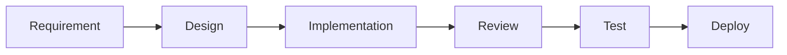
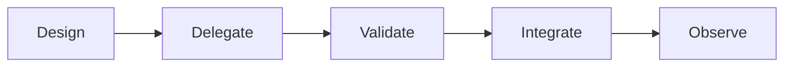
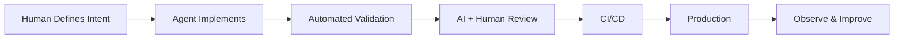

> **The code is being produced faster than I can confidently review, validate, and ship it.**

## Old workflow vs. new workflow

The biggest change in my workflow is not simply that AI writes code faster. It is that my role is gradually moving away from manually implementing every detail and toward **designing, orchestrating, reviewing, and validating the overall result**.

That sounds like a small shift, but it changes where I spend most of my engineering effort.

## Coding is no longer the slowest part

Working with coding agents has changed how I think about development productivity. I can define a task, let an agent explore the codebase, implement the change, add tests, and return a working diff much faster than I could build everything manually.

But implementation is only one stage of software delivery.

AI can compress the implementation stage dramatically, but review, testing, integration, security, and deployment still have their own limits. When those stages cannot keep up, faster coding does not remove the bottleneck. It simply moves it downstream.

This is also the point Red Hat recently raised in [Why faster coding isn't making delivery any faster](https://www.redhat.com/en/blog/why-faster-coding-isnt-making-delivery-any-faster): generating code and delivering reliable software are not the same thing.

I have started to notice this more clearly in my own workflow. An agent can produce a fairly large change while I am still building the mental model needed to judge whether that change is actually good.

## More code is not the same as more productivity

Suppose I used to complete two meaningful changes in a day and AI now helps me produce six. Calling that a 3x productivity increase sounds reasonable at first, but only if the rest of the engineering system can absorb those six changes.

They still need to be understood, reviewed, tested, integrated, and eventually operated in production. If review capacity or CI becomes the constraint, I have not created three times more value. I have created more work waiting to be validated.

This is why metrics such as lines of code, commits, or even pull requests become less useful in an AI-assisted workflow. AI can increase all of them very easily without necessarily improving reliability or delivery speed.

A question I find more useful is:

> **How quickly can an idea become reliable software in production?**

That shifts the focus from output to outcome.

## My workflow is shifting from writing to validating

This is probably the biggest change I notice personally.

When I write code manually, I build context as I go. I know why a function exists, why I chose one abstraction over another, and which trade-offs I made along the way.

With an agent, the implementation can arrive before I have built that same mental model.

So instead of spending most of my time asking *How should I implement this?*, I increasingly find myself asking:

- Does this approach fit the architecture?
- Did the agent reuse the right abstractions?
- Are the tests validating the behavior that actually matters?
- Did the change introduce unnecessary coupling?
- Is this something I would still want to maintain six months from now?

My workflow is starting to look less like:

and more like:

I do not see this as engineering becoming less important.

I see it as **engineering judgment becoming more important than code production itself**.

The agent can produce an implementation quickly. I am still responsible for deciding whether that implementation belongs in the system.

## Faster agents need stronger guardrails

The more autonomy I give agents, the more obvious another requirement becomes: the repository needs to communicate its rules clearly.

An agent can generate perfectly valid code while still making a poor engineering decision. It might duplicate business logic, bypass an existing abstraction, introduce an unnecessary dependency, cross a package boundary, or create coupling that becomes painful later.

Some of those problems will be caught by tests. Others will not.

That is why I increasingly see things such as `AGENTS.md`, architecture boundaries, dependency rules, contract tests, static analysis, security checks, and CI/CD validation as part of the agentic development workflow rather than just supporting tooling.

The goal is not to add more process. It is to make predictable engineering constraints **machine-verifiable**.

If an agent can produce a bad implementation in seconds, I want the system to reject obvious problems just as quickly.

That leaves human attention for the things that still require judgment: architecture, trade-offs, product context, maintainability, and whether we are solving the right problem in the first place.

## The interesting part comes after the agent writes the code

A lot of attention today goes toward which coding agent produces the best code or completes a task fastest.

I think that matters, but I am becoming more interested in a different question:

> **What happens after the implementation is generated?**

Can automated checks validate it? Can another agent review the diff? Can CI enforce architectural boundaries? Can security tooling identify risky changes? Can production observability tell us whether the feature actually behaves as expected?

A more mature workflow starts to look like this:

This is where I think the larger productivity opportunity is.

Not just making the coding agent faster, but designing an engineering system that can safely absorb the speed the agent creates.

That shift is already changing how I work. I spend less time manually producing every implementation detail and more time **designing the approach, orchestrating agents, validating decisions, and improving the system around them**.

AI has made writing code faster.

Now the rest of the engineering workflow has to catch up.

Because the goal was never to generate more code.

**The goal is to ship better software, with confidence, faster.**

---

*Inspired by Red Hat's [Why faster coding isn't making delivery any faster](https://www.redhat.com/en/blog/why-faster-coding-isnt-making-delivery-any-faster) and my own experience working with increasingly agentic development workflows.*
